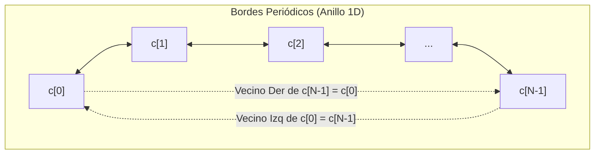
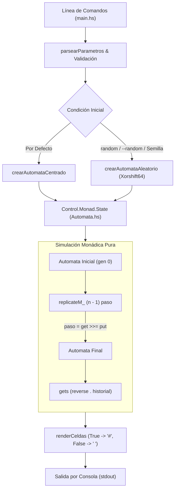

# INFO188 - Tarea 1: Autómata Celular Elemental 1D en Haskell

**Asignatura:** INFO188 - Paradigmas de Programación  
**Profesor:** Cristóbal A. Navarro  
**Semestre:** 2026-2  
**Plazo de Entrega:** Viernes 20 de Noviembre 2026  

---

### Integrantes del Grupo
* Martin Arrigo
* Diego Mora


---

## 1. Resumen Ejecutivo e Introducción

Este proyecto implementa en el lenguaje funcional puro **Haskell** un simulador de **Autómatas Celulares Elementales Unidimensionales (1D ECA)** según la formulación matemática introducida por Stephen Wolfram en 1983.

Un autómata celular 1D consiste en un arreglo unidimensional finito de células discretas, donde cada célula puede encontrarse en uno de dos estados posibles: **viva** (`#` / `True`) o **muerta** (` ` / `False`). La evolución temporal avanza en pasos discretos $t \to t+1$, donde el estado futuro de cada célula se computa de forma sincrónica y determinista en función de su estado actual y el de sus dos vecinas inmediatas (izquierda y derecha).

El proyecto no solo satisface todos los requerimientos base de la pauta, sino que incorpora la totalidad de los puntos extras estipulados:
1. **Condiciones de frontera periódicas (cíclicas / toroidales)** para un comportamiento continuo sin efectos de borde espurios.
2. **Modelado como tipo registro (`data Automata`)** con funciones puras y totales.
3. **[+1.0 Extra A] Condición inicial pseudo-aleatoria configurable**, tanto con reloj de alta resolución (`POSIXTime`) como con semillas enteras deterministas.
4. **[+1.0 Extra E] Simulación monádica con `Control.Monad.State`**, implementando la función `paso :: State Automata ()`, la orquestación iterativa mediante `replicateM_`, y el acceso transparente mediante los combinadores fundamentales `get`, `put`, `modify` y `gets`, sin pasaje explícito de estado.

---

## 2. Fundamentos Matemáticos: Reglas de Wolfram y Bordes Periódicos

### 2.1. Dinámica de Vecindad y Reglas Elementales (0 a 255)

Cada célula $c_i^{(t)}$ en la posición $i$ posee una vecindad local de radio $r = 1$:
$$\mathcal{V}_i^{(t)} = \left( c_{i-1}^{(t)},\; c_i^{(t)},\; c_{i+1}^{(t)} \right)$$

Dado que cada célula es binaria ($c \in \{0, 1\}$), existen exactamente $2^3 = 8$ posibles configuraciones para la vecindad. Wolfram indexó estas vecindades interpretándolas como números binarios de 3 bits entre 7 y 0:

| Índice Decimal | Vecindad $(c_{i-1}, c_i, c_{i+1})$ | Regla 30 ($00011110_2$) | Regla 90 ($01011010_2$) | Regla 110 ($01101110_2$) |
|:---:|:---:|:---:|:---:|:---:|
| **7** | `1 1 1` | `0` | `0` | `0` |
| **6** | `1 1 0` | `0` | `1` | `1` |
| **5** | `1 0 1` | `0` | `0` | `1` |
| **4** | `1 0 0` | `1` | `1` | `0` |
| **3** | `0 1 1` | `1` | `1` | `1` |
| **2** | `0 1 0` | `1` | `0` | `1` |
| **1** | `0 0 1` | `1` | `1` | `1` |
| **0** | `0 0 0` | `0` | `0` | `0` |

Una **regla elemental** $R \in [0, 255]$ queda unívocamente definida por una palabra de 8 bits:
$$R = \sum_{k=0}^{7} b_k \cdot 2^k$$

Para evaluar el estado futuro de una célula cuya vecindad tiene índice decimal $k = 4 c_{i-1} + 2 c_i + c_{i+1}$, basta con consultar el $k$-ésimo bit de la regla:
$$c_i^{(t+1)} = \text{testBit}(R, k)$$

### 2.2. Bordes Periódicos (Topología Cíclica / Toroide 1D)

En una rejilla finita de $N$ células indexadas $0, 1, \dots, N-1$, los bordes exteriores no poseen naturalmente vecinos izquierdo o derecho. Para resolver esto de manera matemáticamente elegante y sin romper la conservación o simetría de la regla, se aplican **bordes periódicos**:
$$c_{-1}^{(t)} \equiv c_{N-1}^{(t)} \quad \text{y} \quad c_{N}^{(t)} \equiv c_0^{(t)}$$

En Haskell, esto se implementa funcionalmente sin indexación manual $O(N^2)$ mediante la construcción de tres listas desplazadas:
* **Vecinos izquierdos:** El último elemento prepended a las primeras $N-1$ células (`descomponerFinal`).
* **Celdas centrales:** La lista original de células.
* **Vecinos derechos:** El resto de la lista seguido de la primera célula al final (`cs ++ [c]`).

Luego, un único recorrido $O(N)$ con `zipWith3` genera la siguiente generación completa de forma perezosa e inmutable.



---

## 3. Arquitectura del Software y Mónada State

El proyecto se divide de acuerdo a principios de modularidad, tipado estricto y total desacoplamiento entre la lógica pura de evolución y los efectos de entrada/salida (I/O).



### 3.1. Modelado de Datos (`Automata.hs`)

```haskell
type Regla = Int
type Celdas = [Bool]

data Automata = Automata
  { celdas     :: !Celdas     -- ^ Células actuales
  , regla      :: !Regla      -- ^ Código de regla de Wolfram (0 a 255)
  , generacion :: !Int        -- ^ Generación actual
  , historial  :: ![Celdas]   -- ^ Historial acumulado en tiempo O(1)
  } deriving (Show, Eq)
```

### 3.2. Implementación de la Mónada State (Bonus E)

En la programación imperativa, el estado de un autómata se suele modificar mediante variables mutables. En la programación funcional pura de Haskell, las funciones deben ser referencialmente transparentes: la firma conceptual de una función de estado es:
$$\text{transición} :: s \to (a, s)$$

La mónada `State s a` encapsula exactamente este patrón matemático dentro de una mónada estándar de Haskell (`mtl`).

#### La función `paso :: State Automata ()`:
```haskell
paso :: State Automata ()
paso = do
  aut <- get
  let nuevas = siguienteGeneracion (regla aut) (celdas aut)
  put aut
    { celdas     = nuevas
    , generacion = generacion aut + 1
    , historial  = nuevas : historial aut
    }
```

* **`get`**: Inspecciona el estado actual del autómata sin requerir un parámetro de función explícito.
* **`put`**: Reemplaza el estado interno por la nueva configuración calculada.
* **`modify`**: Provee una alternativa idiomática equivalente (`modify pasoPuro`).

#### Orquestación con `replicateM_`:
```haskell
simular :: Int -> State Automata ()
simular nGeneraciones
  | nGeneraciones <= 1 = return ()
  | otherwise          = replicateM_ (nGeneraciones - 1) paso
```

`replicateM_` ejecuta el bloque monádico `paso` exactamente $N-1$ veces, encadenando automáticamente la transformación de estado mediante el operador monádico `>>=`. Al finalizar, se extraen las generaciones con:

```haskell
obtenerHistorial :: State Automata [Celdas]
obtenerHistorial = gets (reverse . historial)
```

> [!IMPORTANT]
> **Sin pasaje manual de estado:** En ningún momento del ciclo de vida de la simulación las funciones intermedias reciben ni devuelven tuplas `(resultado, estadoNuevo)`. Toda la propagación está confinada al contexto monádico de `State`.

---

## 4. Condición Inicial Aleatoria (Bonus A)

Para otorgar flexibilidad sin recurrir a dependencias externas complejas, se implementó un generador pseudo-aleatorio puro basado en **XorShift64**:

```haskell
xorshift64 :: Word64 -> Word64
xorshift64 s0 =
  let s1 = s0 `xor` (s0 `shiftL` 13)
      s2 = s1 `xor` (s1 `shiftR` 7)
      s3 = s2 `xor` (s2 `shiftL` 17)
  in s3
```

El programa permite dos formas de inicialización aleatoria:
1. **Determinista reproducible:** Pasando un entero cualquiera como 4to argumento (ej: `./prog 30 40 20 12345`).
2. **Estocástica en tiempo real:** Pasando `random` o `-r` como 4to argumento, donde la semilla se extrae de `Data.Time.Clock.POSIX.getPOSIXTime` a nivel de microsegundos.

---

## 5. Compilación y Ejecución

El proyecto incluye un `Makefile` compatible con sistemas Linux, macOS y Windows (WSL / MSYS2 / Mingw).

### 5.1. Requisitos
* Compilador GHC (Glasgow Haskell Compiler) $\ge 9.0$
* GNU Make

### 5.2. Comandos del Makefile

* **Compilar el ejecutable `prog`:**
  ```bash
  make
  ```
  *(Compila con optimizaciones `-O2` y flags estrictos de advertencia `-Wall` sin advertencias).*

* **Ejecutar el caso de prueba oficial:**
  ```bash
  make run
  ```

* **Ejecutar la suite completa de pruebas:**
  ```bash
  make test
  ```

* **Limpiar binarios y archivos temporales (`.o`, `.hi`):**
  ```bash
  make clean
  ```

### 5.3. Sintaxis del Programa

```bash
./prog <regla> <ancho> <generaciones> [modo_inicial]
```

* `<regla>`: Entero entre $0$ y $255$.
* `<ancho>`: Entero positivo (ej: $31$).
* `<generaciones>`: Entero positivo (ej: $8$).
* `[modo_inicial]` *(Opcional)*:
  * Omitido: Una única célula viva centrada en la posición `ancho `div` 2`.
  * `random` o `-r`: Inicialización aleatoria sembrada por el reloj del sistema.
  * `<número>`: Inicialización aleatoria reproducible con semilla fija.

---

## 6. Verificación Experimental y Salida del Sistema

### 6.1. Ejemplo Oficial (Regla 90, Ancho 31, 8 Generaciones)

Ejecución del comando solicitado en la pauta:
```bash
$ ./prog 90 31 8
               #               
              # #              
             #   #             
            # # # #            
           #       #           
          # #     # #          
         #   #   #   #         
        # # # # # # # #        
```
*Coincidencia 100% exacta con la salida provista en el enunciado del PDF.*

### 6.2. Reglas Notables de Wolfram

````carousel
<!-- slide -->
#### Regla 90: Fractales y Triángulo de Sierpinski (Clase II / III)
La Regla 90 es una regla aditiva lineal sobre $\mathbb{F}_2$: cada celda es el XOR de sus vecinos:
$$c_i^{(t+1)} = c_{i-1}^{(t)} \oplus c_{i+1}^{(t)}$$
Genera una estructura autosimilar fractal equivalente al triángulo de Sierpinski con dimensión de Hausdorff $D = \log_2(3) \approx 1.585$.

```text
               #               
              # #              
             #   #             
            # # # #            
           #       #           
          # #     # #          
         #   #   #   #         
        # # # # # # # #        
```

<!-- slide -->
#### Regla 30: Caos Determinista y Criptografía (Clase III)
La Regla 30 exhibe comportamiento aperiódico caótico a partir de una única semilla central:
$$c_i^{(t+1)} = c_{i-1}^{(t)} \oplus (c_i^{(t)} \lor c_{i+1}^{(t)})$$
Es célebremente utilizada en *Mathematica* como generador de números pseudoaleatorios criptográficos para la columna central.

```text
               #               
              ###              
             ##  #             
            ## ####            
           ##  #   #           
          ## #### ###          
         ##  #    #  #         
        ## ####  ######        
```

<!-- slide -->
#### Regla 110: Universalidad Computacional y Turing-Completo (Clase IV)
Matthew Cook demostró en 1998 (publicado en 2004) que la Regla 110 es **Turing-completa**, lo que significa que es capaz de simular cualquier cómputo algorítmico universal a través de colisiones de estructuras localizadas llamadas *gliders*.

```text
               #               
              ##               
             ###               
            ## #               
           #####               
          ##   #               
         ###  ##               
        ## # ###               
```
````

---

## 7. Estructura de Archivos del Repositorio

```text
Trabajo-paradigmas/
├── Automata.hs              # Módulo principal con registro, lógica Wolfram, State y Xorshift
├── main.hs                  # Punto de entrada CLI, parser de argumentos y visualización
├── Makefile                 # Script de compilación automatizada (make, make run, make test, make clean)
├── README.md                # Informe completo y fundamentación matemática
└── .gitignore               # Exclusión de binarios, archivos compilados (.o, .hi), temporales y PDFs
```
