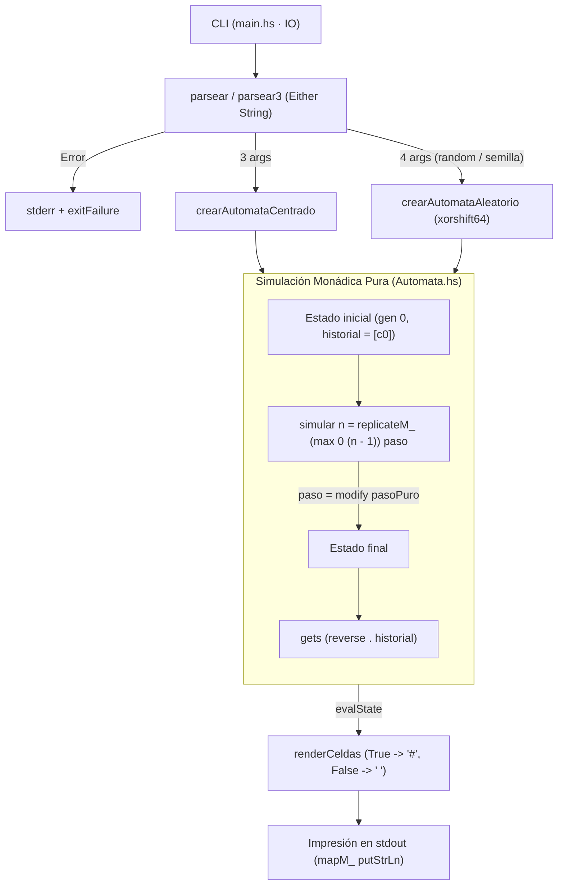

# INFO188 - Tarea 1: Autómata Celular Elemental 1D en Haskell

**Asignatura:** INFO188 - Paradigmas de Programación  
**Profesor:** Cristóbal A. Navarro  
**Plazo de Entrega:** Viernes 27 de Noviembre 2026  

---

### Integrantes del Grupo
* Martin Arrigo
* Diego Mora

---

## 1. Resumen Ejecutivo e Introducción

Este proyecto implementa en **Haskell** un simulador de **Autómatas Celulares Elementales Unidimensionales (1D ECA)** según la formulación de Stephen Wolfram (1983). Un autómata celular 1D consiste en una fila finita de células binarias (**viva** `#` / `True` o **muerta** ` ` / `False`) que evolucionan de forma discreta y sincrónica según el estado actual de cada célula y sus dos vecinas inmediatas.

---

## 2. Fundamentos Matemáticos: Reglas de Wolfram y Bordes Periódicos

### 2.1. Vecindad y Reglas Elementales (0 a 255)

Cada célula $c_i^{(t)}$ posee una vecindad de radio $r = 1$:

$$\mathcal{V}_i^{(t)} = \left( c_{i-1}^{(t)},\; c_i^{(t)},\; c_{i+1}^{(t)} \right)$$

Como cada célula es binaria, existen $2^3 = 8$ configuraciones posibles, indexadas como números binarios de 3 bits entre `0` y `7`:

| Índice Decimal | Vecindad $(c_{i-1}, c_i, c_{i+1})$ | Regla 30 ($00011110_2$) | Regla 90 ($01011010_2$) | Regla 110 ($01101110_2$) |
|:---:|:---:|:---:|:---:|:---:|
| **7** | `1 1 1` | `0` | `0` | `0` |
| **6** | `1 1 0` | `0` | `1` | `1` |
| **5** | `1 0 1` | `0` | `0` | `1` |
| **4** | `1 0 0` | `1` | `1` | `0` |
| **3** | `0 1 1` | `1` | `1` | `1` |
| **2** | `0 1 0` | `1` | `0` | `1` |
| **1** | `0 0 1` | `1` | `1` | `1` |
| **0** | `0 0 0` | `0` | `0` | `0` |

En `Automata.hs`, `fromEnum` convierte `False -> 0` y `True -> 1`, permitiendo calcular el índice $k = 4 c_{i-1} + 2 c_i + c_{i+1}$ y consultar directamente el $k$-ésimo bit de la regla mediante `Data.Bits.testBit`:

```haskell
aplicarRegla :: Regla -> Bool -> Bool -> Bool -> Bool
aplicarRegla r izq centro der =
  testBit r (4 * fromEnum izq + 2 * fromEnum centro + fromEnum der)
```

### 2.2. Bordes Periódicos (Anillo 1D)

En una rejilla de $N$ células indexadas $0, 1, \dots, N-1$, los extremos se conectan de forma circular:

$$c_{-1}^{(t)} \equiv c_{N-1}^{(t)} \quad \text{y} \quad c_{N}^{(t)} \equiv c_0^{(t)}$$


En `Automata.hs` esto se expresa en una sola línea sin indexación manual:

```haskell
siguienteGeneracion :: Regla -> Celdas -> Celdas
siguienteGeneracion _ []        = []
siguienteGeneracion r xs@(c:cs) =
  zipWith3 (aplicarRegla r) (last xs : xs) xs (cs ++ [c])
```

* **Vecinos izquierdos:** `last xs : xs` antepone la última celda al inicio. Aunque tiene $N + 1$ elementos, `zipWith3` se detiene en el largo de `xs` ($N$), descartando el último elemento sin necesidad de usar `init`.
* **Celdas centrales:** `xs`.
* **Vecinos derechos:** `cs ++ [c]` mueve la primera celda al final.

El recorrido completo se ejecuta en tiempo lineal $O(N)$.

---

## 3. Arquitectura del Software y Mónada State

El proyecto separa completamente la lógica pura (`Automata.hs`) de los efectos de entrada/salida (`main.hs`):



### 3.1. Modelado de Datos (`Automata.hs`)

```haskell
type Regla  = Int
type Celdas = [Bool]

data Automata = Automata
  { celdas     :: Celdas
  , regla      :: Regla
  , generacion :: Int
  , historial  :: [Celdas]
  } deriving (Show, Eq)
```

El campo `historial` acumula cada fila nueva al frente de la lista con `(:)` en tiempo $O(1)$, lo que permite que `simular` use `replicateM_` (que descarta el valor de retorno `()` de cada paso) y luego recuperar todas las generaciones en orden cronológico con `reverse`.

### 3.2. Simulación con la Mónada `State` (Extra E)

```haskell
pasoPuro :: Automata -> Automata
pasoPuro aut =
  let nuevas = siguienteGeneracion (regla aut) (celdas aut)
  in aut { celdas = nuevas, generacion = generacion aut + 1, historial = nuevas : historial aut }

paso :: State Automata ()
paso = modify pasoPuro

simular :: Int -> State Automata ()
simular n = replicateM_ (max 0 (n - 1)) paso

ejecutarSimulacion :: Automata -> Int -> [Celdas]
ejecutarSimulacion aut n = evalState (simular n >> gets (reverse . historial)) aut
```

* **`pasoPuro`**: Función pura de transición `Automata -> Automata` (retorna un nuevo registro sin mutación).
* **`paso`**: Encapsula la transición dentro de `State Automata ()` mediante `modify`, actualizando el estado implícito sin pasarlo manualmente entre funciones.
* **`simular`**: Ejecuta `n - 1` transiciones con `replicateM_` (ya que la generación `0` está presente desde el estado inicial; `max 0` evita valores negativos).
* **`ejecutarSimulacion`**: Secuencia `simular n` y `gets (reverse . historial)` con `>>`, evaluando el estado inicial con `evalState` para obtener la lista completa `[Celdas]`.

### 3.3. Validación de Argumentos (`main.hs`)

El módulo `Main` evita funciones parciales como `read`: parsea y valida todos los parámetros usando `readMaybe` dentro de la mónada `Either String`:

```haskell
parsear :: [String] -> Either String (Regla, Int, Int, Maybe String)
parsear [rS, wS, gS]       = parsear3 rS wS gS Nothing
parsear [rS, wS, gS, modo] = parsear3 rS wS gS (Just modo)
parsear _                  = Left "Uso: <regla 0-255> <ancho> <generaciones> [random | semilla]"
```

Si cualquier parámetro no es entero o está fuera de rango (`regla` en `[0, 255]`, `ancho > 0`, `generaciones > 0`), el bloque `do` sobre `Either` se cortocircuita y `main` reporta el error en `stderr` finalizando con `exitFailure`.

---

## 4. Condición Inicial Aleatoria (Extra A)

Para generar filas iniciales aleatorias de forma pura y autocontenida (sin librerías externas) se implementó **XorShift64** combinado con evaluación perezosa (`iterate`):

```haskell
xorshift64 :: Word64 -> Word64
xorshift64 s0 =
  let s1 = s0 `xor` (s0 `shiftL` 13)
      s2 = s1 `xor` (s1 `shiftR` 7)
  in s2 `xor` (s2 `shiftL` 17)

crearAutomataAleatorio :: Regla -> Int -> Word64 -> Automata
crearAutomataAleatorio r ancho semilla =
  let s0 = if semilla == 0 then 0x853c49e6748fea9b else semilla
      c0 = take (max 0 ancho) . map (`testBit` 0) . drop 1 $ iterate xorshift64 s0
  in nuevoAutomata r c0
```

* Si `semilla == 0`, se sustituye por una constante hexadecimal no nula para evitar el estado fijo `0` de XorShift.
* En `main.hs`, se admiten dos modalidades al pasar un 4to argumento:
  1. **Reloj del sistema (`random`, `-r`, `--random`):** `obtenerSemilla` extrae microsegundos desde `Data.Time.Clock.POSIX.getPOSIXTime`.
  2. **Semilla fija reproducible (entero):** Por ejemplo `./prog 90 31 8 42`, convirtiendo el entero a `Word64` con `fromInteger`.

---

## 5. Compilación y Ejecución

### 5.1. Requisitos
* **GHC** (Glasgow Haskell Compiler) $\ge 9.0$
* **GNU Make**

### 5.2. Comandos del `Makefile`

```bash
make        # Compila con: ghc -O2 -Wall main.hs -o prog (cero advertencias)
make test   # Ejecuta pruebas con Regla 90, Regla 30, Regla 110 y modo aleatorio
make clean  # Elimina prog, *.o, *.hi y *.exe
```

### 5.3. Sintaxis de Ejecución

```bash
./prog <regla> <ancho> <generaciones> [modo_inicial]
```

* `<regla>`: Entero entre `0` y `255`.
* `<ancho>`: Entero positivo (cantidad de células por fila).
* `<generaciones>`: Entero positivo (cantidad total de filas a mostrar).
* `[modo_inicial]` *(opcional)*:
  * Omitido: Una célula viva única centrada en `ancho `div` 2`.
  * `random`, `-r` o `--random`: Inicialización aleatoria basada en el reloj POSIX.
  * `<entero>`: Inicialización aleatoria determinista con semilla fija.

---

## 6. Verificación Experimental

### 6.1. Ejemplo Oficial — Regla 90 (Triángulo de Sierpinski)
Regla aditiva $c_i^{(t+1)} = c_{i-1}^{(t)} \oplus c_{i+1}^{(t)}$:

```text
$ ./prog 90 31 8
               #               
              # #              
             #   #             
            # # # #            
           #       #           
          # #     # #          
         #   #   #   #         
        # # # # # # # #        
```

### 6.2. Regla 30 (Comportamiento Caótico)
Regla no lineal $c_i^{(t+1)} = c_{i-1}^{(t)} \oplus (c_i^{(t)} \lor c_{i+1}^{(t)})$:

```text
$ ./prog 30 31 8
               #               
              ###              
             ##  #             
            ## ####            
           ##  #   #           
          ## #### ###          
         ##  #    #  #         
        ## ####  ######        
```

### 6.3. Regla 110 (Turing-Completa)

```text
$ ./prog 110 31 8
               #               
              ##               
             ###               
            ## #               
           #####               
          ##   #               
         ###  ##               
        ## # ###               
```

### 6.4. Modo Aleatorio Reproducible (Extra A, semilla `42`)

```text
$ ./prog 90 31 8 42
 #   ##  ## #### ## #   ###   #
  # ####### #  # ##  # ## ## # 
 #  #     #  ##  ####  ## ##  #
  ## #   # #######  ##### #### 
 ###  # #  #     ####   # #  ##
 # ###   ## #   ##  ## #   ####
   # ## ###  # #######  # ##  #
# #  ## # ###  #     ###  #### 
```

---

## 7. Estructura del Repositorio

```text
Trabajo-paradigmas/
├── Automata.hs   # Registro Automata, reglas de Wolfram, bordes periódicos, State y XorShift64 (68 líneas)
├── main.hs       # CLI, validación con Either/readMaybe, reloj POSIX e impresión (44 líneas)
├── Makefile      # Compilación (-O2 -Wall), ejecución, pruebas y limpieza
├── README.md     # Informe técnico del proyecto
└── .gitignore    # Exclusión de binarios (prog), objetos (.o, .hi), temporales y PDFs
```
